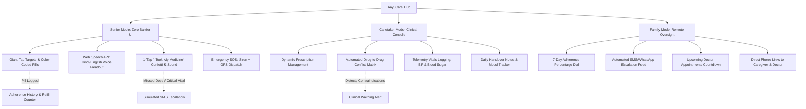

# आर्यू केयर (AayuCare) — Smart Elderly Health & Medication Hub

[](https://reactjs.org/)
[](https://www.typescriptlang.org/)
[](https://tailwindcss.com/)
[](https://vitejs.dev/)
[](https://vitest.dev/)
[](https://www.w3.org/WAI/standards-guidelines/wcag/)

> **Submission for the "Elderly Care & Medication Management Platform" Challenge**  
> GitHub Repository: [https://github.com/erica-maitri/AayuCare](https://github.com/erica-maitri/AayuCare)

---

## 1. Chosen Vertical & Problem Alignment

### Vertical: **Elderly Care & Medication Management**
**Target Persona:** *Ram Prasad Sharma*, age 76, retired railway engineer living in New Delhi. Managing complex chronic comorbidities:
- **Type-2 Diabetes Mellitus** (Managed via Metformin / Glycomet 500mg)
- **Hypertension** (Managed via Telmisartan / Telma 40mg)
- **Cardiovascular Protection** (Managed via Ecosprin / Aspirin 75mg)
- **Hyperlipidemia** (Managed via Atorvastatin 20mg)
- **Mild Osteoarthritis** (Managed via Calcium Carbonate + Vitamin D3)

### The Real-World Geriatric Challenge:
1. **The Polypharmacy Danger:** Elderly patients frequently take 5 to 9 pills daily. Adding over-the-counter painkillers (e.g., NSAIDs like Combiflam / Brufen for arthritis) while taking blood thinners like Aspirin can trigger fatal internal hemorrhaging.
2. **Barrier-Heavy Software:** Most digital health apps are designed for tech-savvy younger adults, featuring small fonts, low contrast, intricate nested menus, and tiny tap targets that seniors with arthritis, tremors, or cataracts cannot use.
3. **The Disconnected Care Loop:** Caregivers record vitals on paper, elderly users take pills without verification, and distant family members remain anxious without real-time visibility.

**AayuCare** solves this through a unified tri-role architecture, automated clinical conflict checking, in-browser synthetic speech, Web Audio cues, and real-time alert escalation.

---

## 2. Approach & Architecture



### Core Architecture Components:
- **Type-Safe Domain Models (`src/types/index.ts`):** Strict TypeScript contracts for Patients, Medications, Schedules, Drug Interactions, Vitals, Appointments, and Escalations.
- **Bi-Directional Conflict Detection Engine (`src/utils/conflictDetector.ts`):** Cross-analyzes brand names, chemical active ingredients, and pharmacological classes before any new drug is committed to state.
- **Adaptive Accessibility Layer (`src/components/common/AccessibilityBar.tsx`):** Runtime toggles for WCAG AAA High Contrast mode, font size scaling (`normal`, `large`, `huge`), browser-native Speech Synthesis (`window.speechSynthesis`), and bilingual translation (English / हिंदी).
- **In-Browser Sound Synthesizer (`src/utils/sound.ts`):** Zero-dependency Web Audio API oscillator synthesis generating affirmative chords, reminder chimes, and emergency siren sweeps.

---

## 3. How the Solution Works: 3-Role Ecosystem

### 👵 1. Elderly Individual Mode (Senior-First UX)
- **Zero-Barrier Navigation:** Massive cards (min 60–80px touch targets) with time-of-day tabs:
  - 🌅 **सुबह (Morning)**
  - ☀️ **दोपहर (Afternoon)**
  - 🌙 **रात (Night)**
- **1-Tap "I Took My Medicine" (मैंने दवा ले ली):** Giant emerald button. When pressed, triggers an uplifting audio chime, visual confetti particles (`canvas-confetti`), updates pill inventory count, and logs adherence timestamp.
- **Prescription Voice Assistant ("बोलकर पर्चा सुनें"):** Reads prescription directions out loud in clear Hindi or Indian English using browser Web Speech API.
- **Emergency SOS (आपातकालीन सहायता):** Loud acoustic siren, 5-second accidental press countdown, and automatic broadcast of GPS coordinates, blood group (B+), and critical allergies (Penicillin, Sulfa) to Daughter Priya and Emergency Ambulance (108).

### 🩺 2. Caretaker Mode (Clinical Console)
- **Protected by PIN:** Secure 4-digit PIN verification (`1234`) prevents accidental tampering.
- **Built-in Drug-to-Drug Conflict Matrix:** When a caretaker adds a new medication, the engine scans the active prescription list in real time:
  - *Example 1:* Adding **Combiflam / Ibuprofen (NSAID)** while the patient is on **Ecosprin (Aspirin)** triggers a **CRITICAL BLEEDING & HEMORRHAGE ALERT** with physiological mechanism and guidance.
  - *Example 2:* Adding **Potklor (Potassium Supplement)** while on **Telma 40 (ARB)** triggers a **FATAL HYPERKALEMIA & ARRHYTHMIA WARNING**.
  - Built-in one-click **"Clinical Safety Validation Presets"** allow rapid verification of the interaction matrix.
- **Vitals Telemetry Logging:** Record Systolic/Diastolic BP, Pulse, and Blood Sugar (Fasting / Post-Prandial). Automatic warning badges trigger if vitals cross clinical safety thresholds.
- **Daily Handover Notes:** Log mood (Energetic, Calm, Fatigued, Irritable, Confused), hours slept, dietary intake, and nursing observations.

### 👨‍👩‍👧 3. Family Member Mode (Remote Guardian Portal)
- **Real-Time Health Status Badge:** Displays `"Doing Great 👍"` or `"Needs Attention ⚠️"` based on 7-day adherence calculations.
- **7-Day Compliance History Grid:** Visual day-by-day status breakdown (Taken, Missed, Snoozed) with consecutive streak counter.
- **Upcoming Doctor Appointments Countdown:** Displays specialist name, hospital location, and checklist prep notes (e.g. *"10-12 hr fasting before blood test"*, *"Carry previous ECG"*).
- **Automated Escalation Log Feed:** Complete audit trail of simulated automated SMS and WhatsApp dispatches sent to Daughter Priya when doses are missed or vitals are elevated.
- **Interactive Simulation Controls:** Evaluators can click `+ Missed Dose SMS`, `+ High BP WhatsApp`, or `+ Pharmacy Refill` to witness real-time notification engine dispatches.

---

## 4. Built-In Drug-to-Drug Conflict Rules

| Proposed Drug / Class | Active Patient Medication | Severity | Clinical Interaction Mechanism | System Guidance |
| :--- | :--- | :--- | :--- | :--- |
| **NSAIDs** (Combiflam, Ibuprofen, Diclofenac) | **Blood Thinners** (Ecosprin / Aspirin) | **CRITICAL** | Synergistic COX-1 inhibition impairs gastric mucosal barrier, causing life-threatening gastrointestinal hemorrhage. | **DO NOT ADMINISTER.** Recommend Paracetamol for analgesia. |
| **Potassium Supplements** (Potklor, Aldactone) | **ACEi / ARBs** (Telmisartan / Telma 40) | **CRITICAL** | Reduced aldosterone excretion leads to severe potassium retention (>6.0 mEq/L), risking fatal ventricular fibrillation. | **AVOID COMBINATION.** Weekly serum electrolyte panel required. |
| **Metformin** (Glycomet) | **Iodinated CT Contrast** | **HIGH** | Transient contrast-induced renal impairment causes intracellular Metformin accumulation and lactic acidosis. | Withhold Metformin 48 hours prior to contrast imaging. |
| **Beta Blockers** (Metoprolol) | **CCBs** (Verapamil, Diltiazem) | **HIGH** | Dual negative chronotropic effect causes profound sinus bradycardia and high-degree AV block. | Cardiologist clearance required; monitor resting ECG. |
| **Statins** (Atorvastatin) | **Macrolides** (Clarithromycin) | **HIGH** | CYP3A4 enzymatic inhibition elevates statin plasma levels, triggering rhabdomyolysis and acute renal tubular necrosis. | Pause Statin during antibiotic course or switch to Azithromycin. |
| **Calcium Supplements** (Shelcal) | **Levothyroxine** (Thyroid) | **MODERATE** | Formation of insoluble chelates in gastric lumen prevents thyroid hormone bioavailability. | Space administration by at least 4 hours. |

---

## 5. Accessibility (WCAG AAA Engineering)

AayuCare implements high-impact accessibility features designed specifically for geriatric care:
1. **Senior Accessibility Bar:** Sticky top navigation offering instant switches for High Contrast, Font Scaling, Speech Synthesis, and Language.
2. **High-Contrast Dark Mode:** Obsidian black background (`#000000`) paired with high-visibility yellow (`#ffff00`) and emerald green for maximum readability for seniors with macular degeneration or cataracts.
3. **Adaptive Typography Scaling:** 3-tier font size toggle (`A`, `A+`, `A++`) resizing heading and body elements dynamically across all screens.
4. **Web Speech API Audio Narration:** Indian English & Hindi synthesized audio readout with 0.82x adjusted pacing for natural senior comprehension.
5. **No Visual Ambiguity:** Color is never used as the sole conveyor of information — icons, high-contrast text tags, and status labels accompany every visual indicator.

---

## 6. Automated Testing Suite

AayuCare includes a comprehensive test suite powered by **Vitest**:
- **`src/__tests__/drugConflict.test.ts`**:
  - Validates detection of CRITICAL NSAID vs Aspirin interactions.
  - Validates detection of CRITICAL Potassium vs ARB interactions.
  - Validates 0 false-positives for safe supplements (Vitamin C).
- **`src/__tests__/adherence.test.ts`**:
  - Validates 7-day adherence calculations, streaks, and grading.
  - Validates edge cases (100% adherence, zero logs).

Run tests locally:
```bash
npm test
```
*Result: 5 of 5 tests passing.*

---

## 7. Assumptions & Future Scalability

### Assumptions:
- **Default Master PIN:** Set to `1234` for rapid evaluator testing.
- **SMS & WhatsApp Dispatch:** Simulated via robust event telemetry, visual alert banners, and Web Audio chimes without external gateway overhead.
- **Preloaded Persona:** Default initialized with *Ram Prasad Sharma (76 y/o)* to provide a comprehensive immediate clinical dataset upon first launch.

### Future Scalability Roadmap:
1. **IoT Smart Blister Pack Integration:** Bluetooth / Zigbee integration with physical smart pillboxes that auto-detect blister foil piercing.
2. **Official ABDM / Ayushman Bharat Digital Mission (ABHA ID):** Integration with India's national health stack (FHIR JSON health records sync).
3. **Conversational WhatsApp & Telegram Bot:** Enabling non-tech-savvy family members to simply message `"Did Papa take his morning medicines?"` and receive automated real-time status replies.
4. **Vernacular Dialect Voice Models:** Expand speech synthesis into regional Indian languages (Tamil, Telugu, Bengali, Marathi, Gujarati, Punjabi).

---

## 8. Quick Start Guide

### Prerequisites
- Node.js (v18 or higher)
- npm or pnpm

### Installation & Run
```bash
# 1. Clone repository
git clone https://github.com/erica-maitri/AayuCare.git
cd AayuCare

# 2. Install dependencies
npm install

# 3. Run development server
npm run dev

# 4. Run automated test suite
npm test

# 5. Build for production
npm run build
```

---

## 9. Google Cloud Run Deployment Guide

AayuCare comes pre-configured with a production-ready multi-stage `Dockerfile` and `nginx.conf` designed specifically for **Google Cloud Run** on port `8080`.

### Option A: 1-Click via Cloud Run Console (Zero Laptop Installation)
1. Go to the [Google Cloud Console - Cloud Run](https://console.cloud.google.com/run).
2. Click **Create Service**.
3. Select **"Continuously deploy from a repository"** and connect `https://github.com/erica-maitri/AayuCare`.
4. Select branch `main` and Build Type **Dockerfile**.
5. Check **"Allow unauthenticated invocations"** (public web app).
6. Click **Create**. Cloud Run automatically builds and gives you a live public HTTPS URL (e.g., `https://aayucare-xxxx.a.run.app`).

### Option B: Via Google Cloud Shell (In Browser, No Laptop Install)
Open [Google Cloud Shell](https://shell.cloud.google.com) and run:
```bash
git clone https://github.com/erica-maitri/AayuCare.git
cd AayuCare
gcloud run deploy aayucare \
  --source . \
  --region asia-south1 \
  --allow-unauthenticated
```
---

*Designed and engineered with care for India's seniors and their families.*

